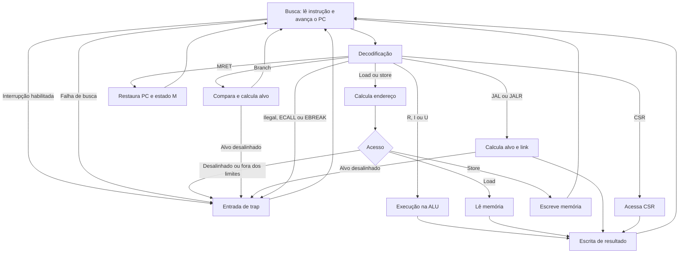
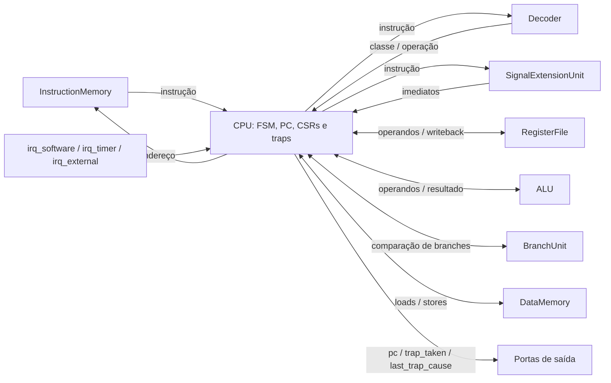

# 32-Bit-Multi-Cycle-CPU

Implementação de um processador RISC-V de 32 bits (RV32IM com Zba, Zbb e Zbs)
em Verilog.
O núcleo é multiciclo: cada instrução passa por etapas de busca, decodificação,
execução, acesso à memória e/ou escrita de resultado, conforme a operação.

O projeto usa memórias separadas para instruções e dados, endereçamento de
bytes para dados e ordem little-endian.

## Requisitos

- Icarus Verilog 12 ou compatível para compilar e simular.
- PowerShell ou shell compatível para executar os comandos de simulação.
- GTKWave opcional para visualizar formas de onda de simulação.
- O testbench fornecido usa recursos de simulação (`$fatal`, `$display` e
  inicialização hierárquica das memórias).

## Estrutura dos arquivos

| Arquivo | Responsabilidade |
| --- | --- |
| `CPU.v` | Módulo principal `CPU`; integra o controlador multiciclo, os CSRs e o tratamento de traps e interrupções. |
| `Decoder.v` | Decodifica instruções RV32I/RV32M, Zba, Zbb e Zbs suportadas e sinaliza instruções ilegais. |
| `SignalExtensionUnit.v` | Extrai e estende os imediatos dos formatos I, S, B, U e J. |
| `BranchUnit.v` | Compara operandos para `BEQ`, `BNE`, `BLT`, `BGE`, `BLTU` e `BGEU`. |
| `ALU.v` | Executa operações aritméticas, lógicas, shifts, multiplicações, divisões e manipulação de bits. |
| `RegisterFile.v` | Banco de 32 registradores de 32 bits; `x0` sempre lê como zero e ignora escritas. |
| `InstructionMemory.v` | Memória de instruções, lida por palavra de 32 bits. |
| `DataMemory.v` | Memória de dados em bytes, com leitura combinacional e escrita síncrona. |
| `Definitions.vh` | Macros de larguras, opcodes, campos `funct` e operações internas da ALU. |
| `tb_CPU.v` | Testes de integração RV32I/RV32M, CSRs e exceções. |
| `tb_CPU_bitmanip.v` | Testa as instruções RV32 das extensões Zba, Zbb e Zbs. |
| `tb_CPU_memory.v` | Testes de acessos à memória, extensão de sinal e traps de memória, incluindo acessos que ultrapassam o limite. |
| `tb_CPU_interrupt.v` | Testes de prioridade de interrupções, handler e `MRET`. |
| `tb_CPU_control.v` | Testes de branches, `JALR`, operações CSR e exceções de CSR. |
| `tb_CPU_fetch.v` | Testes de falha de acesso à memória de instruções e execução do handler. |
| `tb_Decoder.v` | Testes de codificações `FENCE` e instruções não implementadas. |

## Arquitetura

### Fluxo multiciclo

O controlador percorre os estados abaixo. O caminho depende da classe da
instrução; exceções e interrupções convergem para o estado de trap.



### Módulos e caminhos de dados



## Instruções e recursos

### RV32I e RV32M

O núcleo implementa as instruções inteiras da base RV32I:

- Aritméticas e lógicas entre registradores: `ADD`, `SUB`, `SLL`, `SLT`,
  `SLTU`, `XOR`, `SRL`, `SRA`, `OR` e `AND`.
- Aritméticas e lógicas com imediato: `ADDI`, `SLTI`, `SLTIU`, `XORI`, `ORI`,
  `ANDI`, `SLLI`, `SRLI` e `SRAI`.
- Operações com constantes e PC: `LUI` e `AUIPC`.
- Desvios e saltos: `BEQ`, `BNE`, `BLT`, `BGE`, `BLTU`, `BGEU`, `JAL` e
  `JALR`.
- Loads: `LB`, `LH`, `LW`, `LBU` e `LHU`.
- Stores: `SB`, `SH` e `SW`.
- `FENCE` e `FENCE.I` são tratados como no-ops nesta implementação.

Também são implementadas as operações da extensão RV32M:

- Multiplicação: `MUL`, `MULH`, `MULHSU` e `MULHU`.
- Divisão e resto: `DIV`, `DIVU`, `REM` e `REMU`.

### Extensões de manipulação de bits (Zba, Zbb e Zbs)

O núcleo também implementa as instruções RV32 das extensões:

- **Zba:** `SH1ADD`, `SH2ADD` e `SH3ADD`.
- **Zbb:** `ANDN`, `ORN`, `XNOR`, `CLZ`, `CTZ`, `CPOP`, `MIN`, `MINU`,
  `MAX`, `MAXU`, `ROL`, `ROR`, `RORI`, `ORC.B`, `REV8`, `SEXT.B`,
  `SEXT.H` e `ZEXT.H`.
- **Zbs:** `BCLR`, `BCLRI`, `BEXT`, `BEXTI`, `BINV`, `BINVI`, `BSET` e
  `BSETI`.

As formas com índice imediato usam os cinco bits menos significativos do
imediato, conforme RV32. O CSR `misa` anuncia a extensão `B`, além de `I` e
`M`.

Loads e stores usam endereços de byte e ordem little-endian. Acessos de
halfword e word devem estar alinhados; acessos desalinhados geram traps.
Endereços fora do intervalo configurado para as memórias também geram traps.

### SYSTEM, CSR e traps

Além da base RV32I, há suporte a operações CSR da extensão Zicsr e a
funcionalidades de máquina:

- Instruções CSR de registrador e imediato: leitura/escrita, set e clear.
- `ECALL` em modo M, `EBREAK` e `MRET`.
- Exceções síncronas e interrupções de software, timer e externas.
- Prioridade de interrupção: externa, timer e software.
- A entrada de trap grava `mepc`, `mcause` e `mtval`, atualiza `mstatus` e
  transfere o PC para `mtvec`.

CSRs implementados:

| CSR | Comportamento |
| --- | --- |
| `mstatus` | Suporta os campos de máquina `MIE`, `MPIE` e `MPP`; o núcleo opera somente em modo M. |
| `misa` | Somente leitura; retorna `0x40001102`: RV32 com as extensões B, I e M anunciadas. |
| `mie`, `mip` | Máscaras de interrupção de máquina e leitura dos sinais externos de interrupção. |
| `mtvec` | Base do vetor de trap; suporta modo direto e modo vetorizado para interrupções. |
| `mscratch`, `mepc`, `mcause`, `mtval` | Registradores de máquina para software e traps. |
| `mcycle`, `mcycleh`, `cycle`, `cycleh` | Contador de ciclos de 64 bits e aliases de leitura. |
| `minstret`, `minstreth`, `instret`, `instreth` | Contador de instruções aposentadas e aliases de leitura. |
| `time`, `timeh` | Somente leitura; retornam zero. |
| `mvendorid`, `marchid`, `mimpid`, `mhartid` | Somente leitura; retornam zero. |

CSRs não implementados causam exceção de instrução ilegal; escritas em CSRs
somente leitura também causam exceção. As interrupções são amostradas entre
instruções e dependem de `mstatus.MIE`, da máscara em `mie` e da entrada
correspondente. O temporizador é externo: não há periférico de timer neste
projeto. `time` e `timeh` são placeholders somente leitura que retornam zero.

### Causas de traps

`mcause[31]` indica interrupção; os bits restantes contêm o código da causa.
Para exceções síncronas, `mepc` identifica a instrução que causou a exceção.
Para interrupções, `mepc` identifica a próxima instrução a executar.

| Evento | `mcause` | `mtval` |
| --- | ---: | --- |
| Endereço de instrução desalinhado | `0` (`0x00000000`) | Endereço desalinhado. |
| Falha de acesso à instrução | `1` (`0x00000001`) | Endereço da instrução. |
| Instrução ilegal ou acesso inválido a CSR | `2` (`0x00000002`) | Palavra da instrução. |
| Breakpoint (`EBREAK`) | `3` (`0x00000003`) | `0`. |
| Endereço de load desalinhado | `4` (`0x00000004`) | Endereço efetivo. |
| Falha de acesso em load | `5` (`0x00000005`) | Endereço efetivo. |
| Endereço de store desalinhado | `6` (`0x00000006`) | Endereço efetivo. |
| Falha de acesso em store | `7` (`0x00000007`) | Endereço efetivo. |
| Chamada de sistema em modo M (`ECALL`) | `11` (`0x0000000b`) | `0`. |
| Interrupção de software de máquina | `0x80000003` | `0`. |
| Interrupção de timer de máquina | `0x80000007` | `0`. |
| Interrupção externa de máquina | `0x8000000b` | `0`. |

Se um branch ou salto tomado produzir um alvo desalinhado, a causa é `0` e
`mtval` recebe o endereço alvo. Falhas de acesso à memória de dados incluem
acessos fora do intervalo e acessos que ultrapassam o limite da memória.

### Vetor de traps (`mtvec`)

O endereço-base é `mtvec & 0xfffffffc`. O modo é codificado nos dois bits
menos significativos: `0` seleciona modo direto, e `1` seleciona modo
vetorizado para interrupções. Outros valores de modo são normalizados para
modo direto ao escrever `mtvec`.

- **Modo direto:** exceções e interrupções iniciam no endereço-base.
- **Modo vetorizado:** exceções iniciam no endereço-base; interrupções iniciam
  em `base + 4 × código_da_causa` (por exemplo, interrupção externa em
  `base + 44`).

As interrupções são verificadas no estado de busca. Se várias estiverem
pendentes e habilitadas ao mesmo tempo, a prioridade é externa, timer e
software, nessa ordem. Após configurar `mie` e habilitar `mstatus.MIE`, o
handler normalmente lê `mcause`/`mtval` e usa `MRET` para retornar pelo endereço
em `mepc`.

### Limites atuais

- Há apenas o modo de privilégio M; modos S e U não são implementados.
- As extensões A, C, F e D não são implementadas.
- `misa` anuncia RV32B, RV32I e RV32M. CSRs de identificação e `time`/`timeh` retornam
  zero; esses valores não representam identificadores de plataforma nem um
  relógio de tempo real.
- `FENCE` e `FENCE.I` não executam sincronização de caches. A memória de
  instruções é separada e não pode ser alterada por stores.
- A ALU é combinacional, inclusive para multiplicação e divisão; o número de
  ciclos da instrução não modela o tempo de uma unidade iterativa de divisão.
- As memórias internas são pequenas e parametrizáveis, para simulação e uso
  didático; não representam uma memória de 4 GiB.
- Não há suporte a depuração/Debug Spec, MMU, execução em pipeline ou
  periféricos de timer.

## Interface do módulo principal

O módulo de topo chama-se `CPU` e possui os seguintes parâmetros:

| Parâmetro | Padrão | Descrição |
| --- | --- | --- |
| `IMEM_WORDS` | `256` | Quantidade de palavras de 32 bits na memória de instruções. |
| `DMEM_BYTES` | `1024` | Quantidade de bytes na memória de dados. |
| `RESET_PC` | `32'h00000000` | Endereço inicial do PC após reset. |
| `IMEM_INIT_FILE` | `""` | Arquivo opcional para inicializar as instruções com `$readmemh`. |
| `DMEM_INIT_FILE` | `""` | Arquivo opcional para inicializar os bytes de dados com `$readmemh`. |

| Porta | Direção | Descrição |
| --- | --- | --- |
| `clk` | entrada | Clock. |
| `reset` | entrada | Reset síncrono, ativo em nível alto. |
| `irq_software` | entrada | Interrupção de software de máquina. |
| `irq_timer` | entrada | Interrupção de timer de máquina. |
| `irq_external` | entrada | Interrupção externa de máquina. |
| `pc` | saída | Contador de programa atual. |
| `trap_taken` | saída | Pulso de um ciclo quando o trap é aplicado. |
| `last_trap_cause` | saída | Causa do trap mais recente; o bit 31 identifica interrupções. |

O banco de registradores é reiniciado pelo sinal `reset`. As memórias são
inicializadas na simulação; o reset do processador não limpa a memória de
dados.

## Testes e simulação

Com Icarus Verilog instalado, execute no PowerShell, na pasta do projeto:

```powershell
$tests = @('tb_CPU', 'tb_CPU_bitmanip', 'tb_Decoder', 'tb_CPU_memory', 'tb_CPU_interrupt', 'tb_CPU_control', 'tb_CPU_fetch')
$sources = @('CPU.v', 'Decoder.v', 'SignalExtensionUnit.v', 'BranchUnit.v', 'ALU.v', 'RegisterFile.v', 'InstructionMemory.v', 'DataMemory.v')
$build = Join-Path $env:TEMP ('cpu-tests-' + [guid]::NewGuid().ToString('N'))
New-Item -ItemType Directory -Path $build | Out-Null
try {
    foreach ($test in $tests) {
        $output = Join-Path $build ($test + '.vvp')
        iverilog -g2012 -I. -s $test -o $output @sources ($test + '.v')
        if ($LASTEXITCODE -ne 0) { throw "Compilation failed: $test" }
        vvp $output
        if ($LASTEXITCODE -ne 0) { throw "Simulation failed: $test" }
    }
}
finally {
    Remove-Item -LiteralPath $build -Recurse -Force
}
```

No Linux ou macOS, os mesmos testes podem ser compilados manualmente:

```sh
sources="CPU.v Decoder.v SignalExtensionUnit.v BranchUnit.v ALU.v RegisterFile.v InstructionMemory.v DataMemory.v"
for tb in tb_CPU tb_CPU_bitmanip tb_Decoder tb_CPU_memory tb_CPU_interrupt tb_CPU_control tb_CPU_fetch; do
  iverilog -g2012 -I. -s "$tb" -o "/tmp/$tb.vvp" $sources "$tb.v" &&
    vvp "/tmp/$tb.vvp" || exit 1
done
```

Os testes cobrem operações aritméticas e de fluxo de controle selecionadas,
os casos extremos da extensão M (incluindo os bits altos da multiplicação,
divisão por zero e overflow), acessos byte/halfword/word, alinhamento e limites
de memória, CSRs, `misa`, validação de `FENCE`, instruções não suportadas,
traps de instrução e de dados, condições de branch, `JALR`, operações CSR,
prioridade de interrupção, retorno por `MRET` e operações Zba/Zbb/Zbs. Essa é
uma suíte direcionada, não uma verificação exaustiva de todas as instruções,
codificações e combinações possíveis.

| Testbench | Cobertura principal |
| --- | --- |
| [`tb_CPU.v`](./tb_CPU.v) | Operações centrais RV32I, acesso básico à memória, fluxo de controle, RV32M (incluindo divisão por zero e overflow), `misa`, `EBREAK` e instrução ilegal. |
| [`tb_CPU_bitmanip.v`](./tb_CPU_bitmanip.v) | Instruções RV32 das extensões Zba, Zbb e Zbs. |
| [`tb_CPU_memory.v`](./tb_CPU_memory.v) | Loads e stores byte/halfword/word, extensão de sinal, little-endian, alinhamento, limites e valores de `mcause`/`mtval` para traps de memória. |
| [`tb_CPU_interrupt.v`](./tb_CPU_interrupt.v) | Interrupções externa, timer e software, prioridade, handler e retorno com `MRET`. |
| [`tb_CPU_control.v`](./tb_CPU_control.v) | Condições de branch, `JALR`, operações CSR de registrador/imediato e traps por CSR somente leitura ou não implementado. |
| [`tb_CPU_fetch.v`](./tb_CPU_fetch.v) | Falha de acesso à memória de instruções, CSRs do trap e execução do handler. |
| [`tb_Decoder.v`](./tb_Decoder.v) | Codificações aceitas de `FENCE` e rejeição de instruções não implementadas. |

### Programa mínimo

Salve as quatro palavras abaixo, uma por linha, em `program.hex`. Os valores são
instruções RV32I de 32 bits:

```text
00500093
00700113
002081b3
0000006f
```

O programa calcula `x3 = 5 + 7` e fica em um loop. Salve o testbench abaixo como
`tb_program.v` na pasta do projeto; `IMEM_INIT_FILE` carrega o arquivo ao iniciar
a simulação.

```verilog
module tb_program;
    reg clk = 1'b0;
    reg reset = 1'b1;
    wire [31:0] pc;
    wire trap_taken;
    wire [31:0] last_trap_cause;

    CPU #(
        .IMEM_WORDS(16),
        .IMEM_INIT_FILE("program.hex")
    ) dut (
        .clk(clk),
        .reset(reset),
        .irq_software(1'b0),
        .irq_timer(1'b0),
        .irq_external(1'b0),
        .pc(pc),
        .trap_taken(trap_taken),
        .last_trap_cause(last_trap_cause)
    );

    always #5 clk = ~clk;

    initial begin
        repeat (2) @(negedge clk);
        reset = 1'b0;
        repeat (30) @(posedge clk);
        #1;
        if (dut.rf.registers[1] !== 32'd5 ||
            dut.rf.registers[2] !== 32'd7 ||
            dut.rf.registers[3] !== 32'd12)
            $fatal(1, "Resultado incorreto: x1=%0d x2=%0d x3=%0d",
                   dut.rf.registers[1], dut.rf.registers[2], dut.rf.registers[3]);
        $display("PASS: x1=5, x2=7, x3=12");
        $finish;
    end
endmodule
```

Compile e execute no PowerShell a partir da pasta do projeto:

```powershell
iverilog -g2012 -I. -s tb_program -o program.vvp CPU.v Decoder.v SignalExtensionUnit.v BranchUnit.v ALU.v RegisterFile.v InstructionMemory.v DataMemory.v tb_program.v
vvp program.vvp
```

### Depuração com formas de onda

Para inspecionar sinais no GTKWave, compile um testbench de integração com
`iverilog -g2012 -I. -s tb_CPU -o cpu_test.vvp CPU.v Decoder.v SignalExtensionUnit.v BranchUnit.v ALU.v RegisterFile.v InstructionMemory.v DataMemory.v tb_CPU.v`.
Adicione `$dumpfile("cpu_test.vcd");` e `$dumpvars(0, tb_CPU);` a um bloco
`initial` do testbench e rode `vvp cpu_test.vvp`; depois abra
`cpu_test.vcd` com `gtkwave cpu_test.vcd`. Os arquivos de onda não são
necessários para executar a suíte; remova-os depois da inspeção se não quiser
mantê-los no projeto.

## Inicialização das memórias

`IMEM_INIT_FILE` aceita um valor hexadecimal de 32 bits por linha, uma
instrução por palavra. `DMEM_INIT_FILE` aceita um valor hexadecimal de 8 bits
por linha, um byte por linha. Os arquivos são lidos pelo `$readmemh` no início
da simulação; caminhos relativos são resolvidos a partir da pasta de execução
do simulador.

Exemplo de instanciação:

```verilog
CPU #(
    .IMEM_WORDS(256),
    .DMEM_BYTES(1024),
    .RESET_PC(32'h00000000),
    .IMEM_INIT_FILE("program.hex"),
    .DMEM_INIT_FILE("data.hex")
) cpu (
    .clk(clk),
    .reset(reset),
    .irq_software(1'b0),
    .irq_timer(1'b0),
    .irq_external(1'b0),
    .pc(pc),
    .trap_taken(trap_taken),
    .last_trap_cause(last_trap_cause)
);
```
